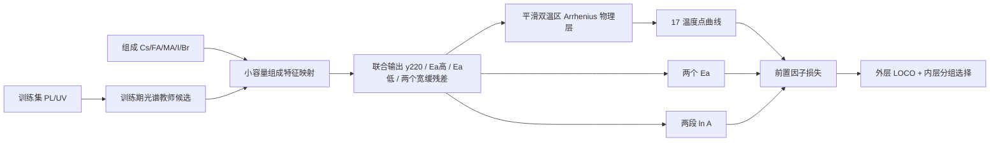

# 钙钛矿变温电导纯 0-shot 物理参数模型 v2

本目录是可直接同步到服务器的独立训练项目。默认训练和推理都只依赖 NumPy、Pandas；不需要 GPU，也不依赖当前平台 Web 服务。

## 这版模型做什么

测试时输入钙钛矿组成，输出：

- 高温段有效活化能 `Ea_high_eV`；
- 低温段有效活化能 `Ea_low_eV`；
- 220 K 参考响应 `anchor_220K_ln_sigmaT`；
- 两段有效前置因子的对数 `ln_A_high`、`ln_A_low`；
- 170–330 K 的 `ln[sigma(T)*T]` 曲线；
- 在当前响应定义成立时换算的 `sigma(T)`；
- 嵌套 LOCO 得到的经验误差范围和组成域提示。

本项目按当前约定解释原始列：

```text
y = ln[sigma(T) * T] = ln(A) - Ea / (kB*T)
```

因此 `Ea` 控制斜率，`ln(A)` 控制直线整体高度。两段模型不直接预测两个相互独立的截距，而是预测共同的 220 K 锚点和两个 `Ea`，再计算：

```text
ln(A_high) = y_220 + Ea_high / (kB*220)
ln(A_low)  = y_220 + Ea_low  / (kB*220)
```

这样两段在过渡区连续，不会因为两个独立截距产生人为跳变。

## 训练逻辑



每个外层目标组分的 17 个电导点、两个 Ea、PL/UV 全部隐藏。模型和损失权重仅在外层训练数据的内层分组验证中选择。PL/UV 只作为训练期候选信息，推理时不需要测目标样品的 PL/UV。当前严格验证最终没有选中光谱候选，说明现有光谱特征尚未证明能稳定改善纯 0-shot。

## 服务器运行

Python 3.10 可直接使用现有 `ai4m-service-py310` 环境。项目的最小依赖为：

```bash
python -m pip install -r requirements.txt
```

运行主模型训练：

```bash
python train_physics_v2.py
```

运行消融用参数头模型：

```bash
python train_parameter_heads.py
```

纯 0-shot 推理：

```bash
python predict_joint.py --request request_example.json --output prediction.json
```

也可以直接传组成和温度：

```bash
python predict_joint.py \
  --composition 'Cs0.2FA0.4MA0.4Pb(I0.6Br0.4)3' \
  --temperatures '170,180,190,200,210,220,230,240,250,260,270,280,290,300,310,320,330'
```

默认关闭宽缓残差，输出严格平滑的双温区物理主曲线。研究残差时可在请求 JSON 中加入 `"include_residual": true`，此时必须同时检查局部斜率和异常点。

目录内已包含本轮使用的两个小型 CSV。如服务器改用新数据，可设置：

```bash
export PEROVSKITE_DATA_CSV=/path/to/transport_data.csv
export PEROVSKITE_OPTICAL_CSV=/path/to/optical_features_raw.csv
export PEROVSKITE_OUTPUT_DIR=/path/to/output
python train_physics_v2.py
```

## 当前严格嵌套 LOCO 结果

| 模型/口径 | 高温 Ea MAE (eV) | 低温 Ea MAE (eV) | 曲线 MAE | pooled R² | `ln(sigma*T)`反向曲线 |
|---|---:|---:|---:|---:|---:|
| v2 联合模型，含宽缓残差 | 0.0596 | 0.0720 | 1.0695 | 0.7837 | 12.3% |
| v2 联合模型，默认物理主曲线 | 0.0596 | 0.0720 | 1.0723 | 0.7827 | 0% |
| v2 参数头消融 | 0.0556 | 0.0668 | 1.1358 | 0.7672 | 32.3% |
| v1 开发版 LOCO | 0.0490 | 0.0616 | 1.0504 | 0.8001 | 0% |

v1 在同一套 LOCO 结果上参与过架构和参数选择，数字偏乐观；v2 使用外层 LOCO、内层分组选择，因此两行不能被当成同口径排行榜。现阶段应把 v2 作为可信基线，把 v1 作为待独立外部组分验证的候选。

v2 联合模型的 220 K 锚点 MAE 为 1.227 个对数单位。高、低温 `ln(A)` MAE 分别为 2.508 和 4.888；换成数量级直觉，大约对应 12 倍和 133 倍的倍率尺度。因此当前数据可以做 0-shot 前置因子估计，但还不能称为精确计算。原因是前置因子同时受可迁移载流子/离子浓度、缺陷、跳跃距离、尝试频率、迁移熵、薄膜形貌、厚度和电极接触影响，而当前纯 0-shot 输入只有组成。

另外，默认物理主曲线保证 `ln[sigma*T]` 随温度非减，但由此换算的 `sigma` 仍有 15.4% 的组分出现局部下降。这不是代码矛盾：当低温有效 `Ea < kB*T` 时，`sigma = exp(y)/T` 的 `1/T` 项可能占优。是否应硬性要求 `sigma` 单调，需要合作方确认原始响应、导电通道和物理目标。

## 文件说明

- `train_physics_v2.py`：推荐主训练，联合损失、嵌套 LOCO、完整模型导出。
- `predict_joint.py`：推荐纯 0-shot 推理入口。
- `train_parameter_heads.py`：独立参数头消融实验。
- `predict.py`：参数头消融模型推理。
- `model_artifact.json`：联合模型完整参数和嵌套 LOCO 误差标定。
- `head_model_artifact.json`：参数头消融模型。
- `nested_loco_*.csv`：联合模型逐组分、逐温度验证结果。
- `head_nested_*.csv`：参数头消融结果。
- `data/`：本轮训练用电导表、光谱特征表和 v1 参考结果。

## 下一轮需要的新证据

1. 原始 `sigma`、单位、样品厚度、器件面积、电极和测试方向；确认 `ln_sigmaT` 的严格定义。
2. 两个温区和 220 K 分界的实验/机理依据，以及是否每个组分都共用同一分界。
3. DFT/CIF/缺陷形成能/迁移势垒等文件与组成 ID 映射。目前未交付，模型没有真正结构或 DFT 输入。
4. 制备批次、退火、湿度、扫描方向和重复测量，用于区分材料差异与批次差异。
5. 至少一批完全不参与开发的新组分，作为最终锁定测试集。

